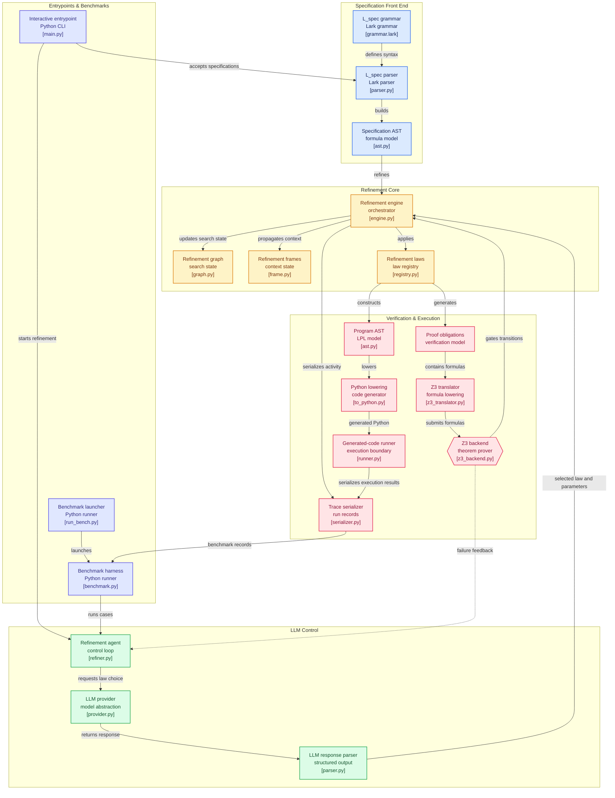

# FormalLLM

**DISCLAIMER: This project is not an original work. It is a completely personal, independent implementation of the architecture described in the paper "Automated Program Refinement: Guide and Verify Code Large Language Model with Refinement Calculus" (Refine4LLM).** 

All core theoretical concepts, refinement laws, the $L_{spec}$ specification language, and the verification loop architectures are derived entirely from the original authors' research.

## Overview
FormalLLM is an implementation of a neuro-symbolic refinement engine. It mathematically bridges the gap between Large Language Models (LLMs) and formal methods (Refinement Calculus) to generate provably correct code. 

Instead of relying on an LLM to generate an entire correct program at once, FormalLLM breaks the problem down into a tree of smaller, mathematically verifiable sub-specifications.

## Architecture



1. **L_spec Parser**: A Lark-based grammar parser that converts textual mathematical preconditions and postconditions into an Abstract Syntax Tree (AST).
2. **Refinement Calculus Engine**:
   - Implements strict refinement laws (Assignment, Sequential Composition, Alternation, Iteration, and Skip).
   - Handles capture-avoidant substitution (alpha-renaming) for quantified variables during refinement steps.
3. **Z3 Verification Backend**: Translates the AST's proof obligations into `z3-solver` constraints. It provides deterministic feedback (`PROVED`, `FAILED` with counterexamples, or `UNKNOWN`).
4. **LLM-Guided Automated Refiner**:
   - An intelligent agent loop that dynamically prompts an LLM with the current refinement state.
   - Evaluates the LLM's chosen law and parameters.
   - Implements a **Counterexample-Guided Feedback Loop** (feeding Z3 failures back into the LLM prompt).
   - Features a robust recursive backtracking/fallback mechanism if the LLM leads the refinement down an unprovable path.

## Lean-native core (`FormalLLM/lean/`)
A second engine that keeps the method but uses Lean 4 as its only prover (decided after the 2026-10-06 meeting; the Z3 engine above is untouched). A task is written in [Verina](https://github.com/sunblaze-ucb/verina)'s format (a Lean precondition and postcondition); a *goal* is the subtype `{ ρ : T // post ρ }`; the four laws `term`, `cases`, `bind`, `loop` build a Lean term of that type, so Lean checks the whole derivation and the result is a program together with a proof that it meets the specification.

```python
with LeanSession() as lean:
    derivation = Derivation(LeanTask.from_dir("benchmarks/datasets/lean_specs/he_060_sum_to_n"), lean)
    derivation.apply_tree(ORACLES["he_060_sum_to_n"])      # or step by step: derivation.apply(goal_id, Loop(...)) / LeanAgent(provider).solve(...)
    print(derivation.certify())                            # compiles, no sorryAx in #print axioms, passes the task's tests
```
Pieces: `session.py` (managed Lean REPL), `task.py`, `laws.py`, `engine.py`, `lemmas.py` (proved list lemmas for the tactic cascade), `agent.py` (model-driven loop with Lean's feedback). `benchmarks/datasets/lean_specs.py` holds 37 HumanEval problems and 5 classic algorithms (among them the paper's square-root example) specified in Lean, validated against HumanEval/EvalPlus data and hand-written tests; `lean_oracle.py` has a hand-written derivation for 36 of them, `verina_oracle.py` for 19 of Verina's own tasks. Design and results: `Reading Material/22`–`24`. Tests: `FormalLLM/tests/test_lean_core.py`, `test_lean_agent.py`, `test_lean_specs.py`.

## Benchmarking
The `benchmarks/` directory contains an extensive test suite used to evaluate how well different local LLMs (like Llama 3.1, Qwen 3.5) navigate the formal refinement process.

- **Tier A**: Single terminal laws (e.g., trivially implied postconditions or direct assignments).
- **Tier B**: Structural decompositions (e.g., sequential composition or alternation).
- **Tier C**: Complex, nonlinear problems from the original paper (e.g., tight square root bounds or proper loop invariants).

To reproduce the benchmark runs:
```bash
python benchmarks/run_bench.py --configs llama3.1 qwen3.5-think --laws all
```
The results are output in JSON Lines format and can be analyzed using `benchmarks/analyse.py`.

## Quick start

One command from a specification to a program that Coq and Lean have re-checked:

```bash
export FORMALLLM_REMOTE_AUTH="user:password"        # only for the hosted model; never commit it
python main.py --case C5-sqrt-paper --config gpt-oss-120b-low --assist --certify coq lean --run N=10,e=1
```

| Want | Command |
|---|---|
| list the built-in specifications | `python main.py --list-cases` |
| measure reliability over many trials (counts + 95 % intervals) | `python benchmarks/reliability.py --config gpt-oss-120b-low --trials 100 --assist --certify coq` |
| re-derive a stored study offline, without the model | `python benchmarks/replay.py "benchmarks/results/reliability/*.jsonl" --assist --strict 0` |
| the paper's Table 7 analogue | `python benchmarks/classic.py --certify coq lean` |
| HumanEval / EvalPlus: direct baseline, formal-spec pilot | `python -m benchmarks.datasets.direct_baseline` · `python -m benchmarks.datasets.he_refine` |
| the other benchmark cases, many trials each, one table (resumable) | `python benchmarks/reliability_batch.py --trials 20` (Windows: double-click `run_other_cases.bat`) |
| re-measure integer division after the assist fix, plus the impossible-spec control | `python benchmarks/reliability_batch.py --prefix v7 --cases D1-intdiv A4-impossible` (Windows: double-click `run_v7_check.bat`) |
| the HumanEval pilot with the model (3 tries per problem) | `python -m benchmarks.datasets.he_refine --repeats 3 --assist --strict 0 --certify coq --out pilot.jsonl` (Windows: double-click `run_humaneval_pilot.bat`) |
| what the pilot can at best score: hand derivations through the engine and the real tests (no model) | `python -m benchmarks.datasets.he_oracle` |
| do the proved programs also *run* correctly? (no model) | `python benchmarks/cross_check.py "benchmarks/results/reliability/v6_*.jsonl" --random 200` |
| re-score stored HumanEval baseline answers offline | `python -m benchmarks.datasets.direct_baseline --reevaluate FILE` |

Provers: Z3 searches (fast, gives counterexamples); `--certify coq lean` re-checks every proof obligation of the finished derivation; `--backend z3+lean` lets Lean prove steps Z3 leaves undecided. The step-by-step explanation of every part, written for a newcomer, is in [`Reading Material/`](Reading%20Material/00_START_HERE.md).

## Dependencies
- Python 3.10+
- `lark` (for parsing $L_{spec}$)
- `z3-solver` (for automated theorem proving)
- `pytest` (for running the validation suites)
- optional: Rocq/Coq 9 (`coqc` on `PATH`) and Lean 4 + Mathlib (via `elan`) for certification; `evalplus` for the HumanEval experiments

## Installation & Testing

```bash
pip install -r requirements.txt
python -m pytest FormalLLM/tests/
```

The Lean-native core needs Lean 4 + Mathlib and the Lean REPL (`~/.formalllm/repl`, built from `leanprover-community/repl`; see `Reading Material/22`); its tests skip themselves when these are missing. All of them share one Lean process (about 10 s to start):

```bash
python -m pytest FormalLLM/tests/test_lean_*.py
python -m FormalLLM.lean oracle he_060_sum_to_n --source        # derive and certify one task, print the Lean file
python benchmarks/datasets/lean_specs.py validate               # the 42 specifications against HumanEval/EvalPlus data (imports Mathlib)
python benchmarks/datasets/lean_oracle.py --imports full        # all 36 hand-written derivations
```

## Citation & Attribution
This implementation studies and reproduces the mechanics of:
> **Automated Program Refinement: Guide and Verify Code Large Language Model with Refinement Calculus (Refine4LLM)**
> *(Please refer to the original publication for the full theoretical proofs, completeness guarantees, and algorithmic definitions).*
